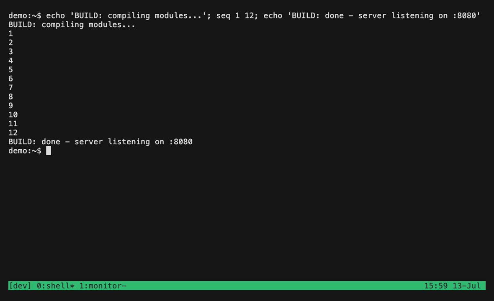

<h2>
  <picture>
    <source media="(prefers-color-scheme: dark)" srcset="./docs/public/assets/logo-white.svg">
    
  </picture>
  &nbsp;&nbsp;&nbsp;lazy-tmux
</h2>

[](https://github.com/alchemmist/lazy-tmux/actions/workflows/quality-graph.yml)
[](https://github.com/alchemmist/lazy-tmux/releases/latest)
[](https://github.com/alchemmist/homebrew-tap)
[](https://aur.archlinux.org/packages/lazy-tmux)
[](https://hub.docker.com/r/alchemmist/lazy-tmux)
[](go.mod)
[](LICENSE)
[](https://lazy-tmux.xyz/installation/)

Project architect: [@alchemmist](https://github.com/alchemmist)

CLI written in Go for saving and restoring tmux sessions lazily. Key features:

- Save sessions: current, specific, or all — including windows, panes, layouts, running commands, and scrollback history.
- Lazy restore: restore only what you need, avoiding high RAM usage.
- Autosave daemon: periodically snapshots all sessions in the background (single instance, no conflicts).
- Interactive TUI browser: tree view (sessions/windows) + table (commands, snapshot time, counts, status) with fuzzy search.
- Keyboard-driven picker for fast search, navigation, and manage sessions and windows directly inside picker tree.
- Lightweight `picker --sessions-only` mode for Alt-Tab-style switching in a narrow tmux popup.
- In the picker, press `Option/Alt` + a window number (`1`, `2`, `3`, …) to immediately restore the first matching window from the current results.
- Independent Codex, Antex, and Claude Code integrations preserve the agent identity and exact conversation. Verified Antex bindings remain compatible; Codex and Claude require explicitly installed lifecycle hooks. Unverified conversations are never guessed from directory recency.
- Flexible sorting via `--session-sort` or `--window-sort` (by last-used, time, size, name, command, etc.).
- Optional `fzf` integration via `--fzf-engine` (lighter and no dependencies binary, but without full keyboard control and TUI picker); add `--windows` to pick a specific window instead of a whole session.
- Bootstrap restore on tmux startup: auto-restore latest or specific session.
- Full environment snapshots: restore pane layout and commands (e.g. `npm`, `docker-compose`, `nvim`).
- Optional scrollback capture: preserve and replay previous terminal output.

Save your sessions, kill the entire tmux server, then bring everything back from the TUI picker:



Check out [lazy-tmux.xyz](https://lazy-tmux.xyz) for more information about installation and usage!

Just for building from source you need to have installed go and cloned this project. After that run:

```bash
make build
```

Binary will be compiled in `bin/lazy-tmux`. For more development options check out `Makefile` tasks.

> [!NOTE]
> **tmux versions:** lazy-tmux supports every tmux release from **2.9 through 3.7b**,
> verified on each one by the CI version matrix. Newer releases are added as they ship.

For configuration, CLI reference, and usage, see the docs at
[lazy-tmux.xyz](https://lazy-tmux.xyz).

## Agent integrations

Codex, Antex, Claude Code, and Pi are independent clients. Their commands, configuration homes, conversation IDs and statuses never migrate to another client automatically. Each has its own `enabled` and `home` settings under `[integrations.codex]`, `[integrations.antex]`, `[integrations.claude]`, and `[integrations.pi]`.

Antex publishes a native binding (Antex 0.1.8+; 0.1.9+ also publishes startup receipts). Existing verified Antex snapshots work without reconfiguration.

For Codex and Claude, install lifecycle hooks once using an installed, stable lazy-tmux executable:

```sh
lazy-tmux integrations setup codex
lazy-tmux integrations setup claude
lazy-tmux integrations doctor
lazy-tmux agent-session --agent codex --pane %1
```

Codex uses `<home>/hooks.json`; Claude uses `<home>/settings.json`. The installer preserves other hooks and settings, keeps a `.lazy-tmux.bak` backup, and supports `--uninstall`. `claude-hooks` remains a compatibility command for the new setup. Review and trust installed hooks inside the client: installation does not bypass client trust or administrator policies. Older `hook claude-status` files are not used for identity or status.

Hooks must execute as descendants of the local client that owns the tmux pane. A daemon, remote app-server, nested agent, suspended process or reused PID cannot claim a panel without ownership proof. Unsupported launch flags are rejected rather than discarded. Supported profile/model and other known launch options retain argument boundaries, including paths with spaces. Initial prompts and images are not replayed. Current runtime settings should be persisted by the client; launch options describe the original invocation.

Pi is identified from its public session JSONL header, never from terminal output. Snapshots store the Pi session ID, file, working directory, and model, and restore with `pi --session <file>`. `--no-session`, ambiguous panes, missing files, and non-session print/RPC invocations remain unbound and are marked for manual review. Set `PI_CODING_AGENT_DIR` and `PI_CODING_AGENT_SESSION_DIR` when using non-default Pi locations.

The picker displays `?` when an agent has no verified identity and `↻` when restoration is pending. Run `integrations doctor` for setup and per-pane details. A missing live status stays unknown. Hook status updates for another conversation do not modify the current panel.

Claude, Codex, and Antex activity is refreshed from current ownership-verified tmux bindings, not saved `Agent.Status` fields. Each picker refresh shares one live capture across these integrations and concurrent quick-picker checks; changes appear without autosave. Matching requires the same client, conversation ID, configuration home, and working directory. Exited clients, reused PIDs, switched conversations, pending restores, and ambiguous duplicate clients produce no live activity. Antex reads rollout lifecycle events only after this live-owner check and validates the rollout's ID and working directory. Both typed and legacy verified Antex bindings are supported. Manually repaired identities remain available for restore but do not establish live ownership.

### Old snapshots and recovery

Snapshot format 2 stores the agent and restoration arguments explicitly and continues to read format 1. There is no automatic `codex` to `antex` conversion. Existing snapshots already rewritten by older releases cannot be classified reliably without the original backup or user knowledge.

Legacy unverified IDs require explicit repair. Preview first, then repeat with `--apply`:

```sh
lazy-tmux integrations repair --session work --window 1 --pane 0 --agent codex --id EXACT_ID
lazy-tmux integrations repair --session work --window 1 --pane 0 --agent codex --id EXACT_ID --apply
```

Repair changes only the selected saved pane and writes `.pre-agent-repair.bak` before applying. It does not start or stop clients or claim that a live process was verified. Use repair on an offline session so autosave cannot overwrite a manual edit. Normal autosave also preserves unverified legacy snapshots in `.pre-binding-v1.bak`. Keep these backups until recovery is complete; do not downgrade a writer against format-2 snapshots.

Restoration keeps the original intent until a matching startup receipt or a verified live binding is observed. Startup failures leave the intended conversation available for retry rather than replacing it with a shell snapshot. This applies to all three clients.

### Verification levels

`make check` covers all adapters through replayed lifecycle events and real isolated tmux processes, including multiple clients sharing a working directory. These tests require no accounts; they do not certify actual upstream client versions.

`make real-agent-test` is a separate opt-in smoke test using actual installed `codex` and `claude`. It starts a new conversation and verifies restoration of the same ID. It requires dedicated authenticated client homes, hooks installed and trusted there, and exact version output strings:

- `LAZY_TMUX_REAL_CODEX_HOME` and `LAZY_TMUX_REAL_CODEX_VERSION`
- `LAZY_TMUX_REAL_CLAUDE_HOME` and `LAZY_TMUX_REAL_CLAUDE_VERSION`

Each dedicated home must contain `.lazy-tmux-test-home` with `codex` or `claude`, respectively. Never point the test at your normal client home. The target fails when required inputs are missing; the ordinary suite explicitly skips these credential-dependent tests. No Codex/Claude client version is certified solely by the replay tests. The current implementation follows [Codex hooks](https://learn.chatgpt.com/docs/hooks) and [Claude Code hooks](https://code.claude.com/docs/en/hooks); unsupported versions, missing trust and unprovable daemon ownership are reported as unverified.

### Pi support (automatic)

Pi's identity extension is embedded in the lazy-tmux binary. Running `lazy-tmux
setup`, `bootstrap`, `daemon`, `picker`, `save`, `sleep`, `restore`, or `wakeup`
installs/updates it in `<pi-home>/extensions/lazy-tmux-pi.ts`. Normal tmux startup
with bootstrap or the autosave daemon therefore prepares Pi automatically, before
new Pi clients launch. No npm package or manual file copying is required.

New Pi clients load it automatically. Pi clients already running before the first
installation need a restart or `/reload` **when idle**; lazy-tmux never sends keys,
reloads clients, or restarts existing agents automatically. Merely unpacking a
binary without running lazy-tmux cannot configure a Pi process that already
started. Disabled extensions/project trust restrictions in Pi still apply.

The extension uses Pi's public `sessionManager.getSessionFile()` API and publishes
the exact file, owner PID, and process start time on startup, resume, fork, and after turns. lazy-tmux
checks that the owner is a foreground Pi process in the pane, validates the JSONL
header, and stores the exact ID and path. It never chooses a history by timestamp
or assumes that the only file in a directory belongs to a live client. Large
JSONL records and symlinked working directories are supported.

```sh
lazy-tmux integrations setup pi             # explicit install/update
lazy-tmux integrations doctor               # installation and live identity
lazy-tmux integrations setup pi --uninstall # persistent automatic-setup opt-out
```

Explicit setup re-enables automatic installation after uninstall. Set
`[integrations.pi] enabled = false` (or disable integrations globally) to disable
Pi integration altogether. Non-owned files at the managed filename are never
overwritten; managed upgrades preserve the previous file in `.lazy-tmux.bak`.

`PI_CODING_AGENT_DIR` and `PI_CODING_AGENT_SESSION_DIR` select custom default homes
and session directories; explicit `[integrations.pi] home` and `session_dir`
configuration takes precedence. Update the executable used by your autosave daemon
as well as the CLI and restart the daemon after upgrading: an already running
daemon continues using its old code. Existing snapshots without Pi identity are
not guessed or automatically repaired.

#### Pi activity in the picker

Pi uses the same working spinner and status colors as Antex and Claude, including
working-session detection in the quick picker:

- `working`: agent execution or context compaction; the indicator animates.
- `awaiting_input`: the turn completed or was aborted, or an input/editor prompt is open.
- `awaiting_decision`: a confirmation/selection prompt is open.
- `idle`: the client has started or switched sessions and is not running a turn.
- `error`: the model run or compaction failed.

The embedded extension publishes lifecycle events, not terminal text. Each picker
refresh reads current ownership-verified tmux bindings once, matching the exact
session ID and history file. It does not wait for autosave, replay an old snapshot
status, or infer activity from the selected model. Exited clients, reused PIDs,
changed conversations, pending restores, and ambiguous duplicate clients do not
produce a borrowed or stuck spinner. Prompt states require Pi versions exposing
UI-prompt lifecycle events; older clients do not guess these states.

After upgrading the binary, already running Pi clients must load the updated
extension with `/reload` when idle (new clients load it automatically). The older
identity-only extension remains compatible with restoration but reports no live
activity; a verified conversation without activity data is not shown as needing
identity setup.
