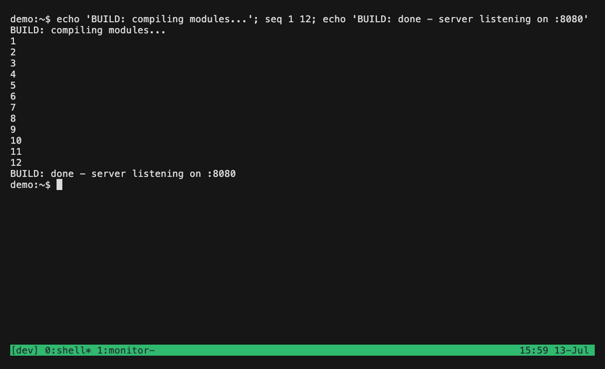

<h2>
  <picture>
    <source media="(prefers-color-scheme: dark)" srcset="./docs/public/assets/logo-white.svg">
    
  </picture>
  &nbsp;&nbsp;&nbsp;lazy-tmux
</h2>

Project architect: [@alchemmist](https://github.com/alchemmist)

Save your tmux sessions, then use the interactive picker to restore just the sessions or windows you need. Snapshots preserve pane layouts, running commands, and optional scrollback history.

For installation, usage, and the full CLI reference, see [lazy-tmux.xyz](https://lazy-tmux.xyz).
